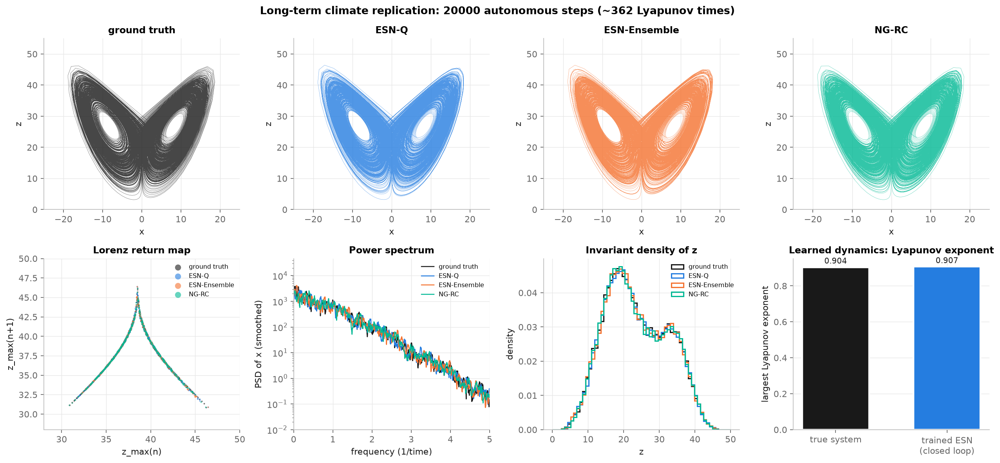

# RC-expl: Reservoir Computing & Neurochaos Learning

A research toolkit and a set of reproducible experiments for two
brain-inspired learning paradigms that train without backpropagation:

| Track | Task | Models |
|---|---|---|
| **Reservoir computing** (`rcexpl.reservoir`) | forecasting chaotic dynamical systems | Echo State Networks (shallow, deep, consensus ensembles), Next-Generation RC, six reservoir topologies, memory/capacity diagnostics |
| **Neurochaos learning** (`rcexpl.neurochaos`) | classification | GLS chaotic neurons, ChaosFEX feature extraction, ChaosNet, ChaosFEX + ML pipelines |

The repository has **15 experiments** (7 RC, 8 NL), **30 unit tests** and a
full technical report. Every figure and table in `results/` is regenerated
by one command.

<p align="center">
  <br>
  <em>A trained ESN run autonomously for 20 000 steps (~360 Lyapunov times) reproduces the Lorenz attractor,
  its return map, power spectrum and invariant density. Its learned Lyapunov exponent is 0.907; the true value is 0.904.</em>
</p>

---

## Highlights

### Reservoir computing
* **Benchmark on 6 chaotic systems × 5 models.** Each model is tuned by random
  search on closed-loop forecasting skill and tested on 20 held-out forecast
  windows. Horizons reach **12–13 Lyapunov times on Lorenz** and **11 on
  Rössler**. On the logistic and Hénon maps, NG-RC reaches about 25 Lyapunov
  times, limited only by float64 round-off ([RC-01](#experiments)).
* **ESN ensemble with consensus feedback** (new): the averaged prediction is
  fed back to every member. It has the highest mean horizon on Mackey-Glass and
  Rössler and the most faithful long-term climate (RC-01, RC-05).
* **Quadratic readout = 6× smaller reservoir.** With `[x, x²]` features, N = 200
  units forecast Lorenz as well as N = 1200 units with a linear readout (RC-04).
* **Learned dynamics, not just curve fitting.** The Lyapunov exponent of the
  trained closed-loop ESN, computed by Benettin's method in reservoir space,
  matches the true system to 0.3% (RC-05).
* **Topology study.** A deterministic **ring reservoir** forecasts Lorenz as
  well as random graphs, beats them on NARMA-10 (NRMSE 0.255 vs 0.293) and
  nearly doubles the memory capacity (35 vs 19) (RC-02).
* **Memory–nonlinearity trade-off, with a symmetry control.** Without a bias, a
  `tanh` reservoir has *exactly zero* quadratic capacity, as the odd-symmetry
  argument predicts. Quadratic capacity peaks at ρ ≈ 0.8, linear memory at
  ρ ≈ 1.0 (RC-03).

### Neurochaos learning
* **Exact shared-trajectory ChaosFEX** (new): all neurons with the same initial
  activity follow one orbit, so we simulate it once and read every feature
  from prefix sums. Results are **identical to the naive simulation** (to
  1e-12) and up to **83× faster** (NL-07).
* **Multi-population ChaosFEX** (new): several initial activities per input.
  On spirals, F1 rises from 0.76 to **0.995**. The worst-case F1 over random q
  rises from 0.76 to 0.92 on iris. It is the **best neurochaos model in nested
  CV** (mean F1 0.952 over 8 datasets) (NL-01, NL-03, NL-06).
* **ChaosNet-Std** (new): standardising the features before the cosine
  similarity improves ChaosNet on 7 of 8 datasets (+3.1 F1 points on average) (NL-01).
* **The ε-resonance effect, replicated.** Accuracy peaks at an intermediate
  firing neighbourhood ε on every dataset; for wine, F1 goes 0.41 → **0.91** → 0.42 (NL-04).
* **Feature ablation.** The *variance* feature alone outperforms the standard
  four-feature ChaosFEX set (NL-05).
* **Honest baselines.** Under nested CV, tuned classical models (MLP, SVM,
  kNN, RF) still edge out the best neurochaos model, and we **could not
  reproduce** a neurochaos advantage in the 1–3 samples/class regime with
  fixed hyperparameters (NL-01, NL-02). See [the report](docs/REPORT.md#discussion).

---

## Installation

```bash
git clone https://github.com/Vishnu-0077/RC-expl.git
cd RC-expl
python -m venv .venv && source .venv/bin/activate
pip install -e ".[dev]"
pytest -q                      # 30 tests
```

Requirements: Python ≥ 3.10, NumPy, SciPy, scikit-learn and Matplotlib. Nothing else.

## Quick start

```python
from rcexpl.datasets import load_system, load_classification
from rcexpl.reservoir import ESN, ESNEnsemble, NGRC
from rcexpl.neurochaos import ChaosNet, chaosfex_pipeline
from rcexpl.metrics import valid_prediction_time

# --- Forecast the Lorenz system autonomously
ts = load_system("lorenz", n=10000)                  # also computes lambda_max
z = (ts.data - ts.data.mean(0)) / ts.data.std(0)
esn = ESN(n_units=400, spectral_radius=0.9, leak_rate=0.6, input_scaling=0.3,
          readout="quadratic").fit(z[:6000 - 1], z[1:6000])
forecast = esn.generate(1000, warmup=z[6000:6300])    # closed loop
print(valid_prediction_time(z[6300:7300], forecast) / ts.lyapunov_time_steps(), "Lyapunov times")
print("learned Lyapunov exponent:", esn.lyapunov_exponent(z[6000:6300]) / ts.dt)

# --- Classify with chaotic neurons (any sklearn API works: CV, grid search, pipelines)
from sklearn.svm import SVC
from sklearn.model_selection import cross_val_score
X, y = load_classification("wine")
clf = chaosfex_pipeline(SVC(), q=[0.13, 0.37, 0.61, 0.83], b=0.499, epsilon=0.1)
print(cross_val_score(clf, X, y, cv=5).mean())
```

More examples are in [`examples/quickstart.py`](examples/quickstart.py).

## Experiments

```bash
./run_all.sh                    # full run, ~50 min on 16 cores
RCEXPL_QUICK=1 ./run_all.sh     # smoke test, a few minutes
python experiments/reservoir/rc05_attractor_climate.py   # or any single experiment
```

| ID | Question | Script | Main figure |
|---|---|---|---|
| RC-01 | How far ahead can each RC model forecast 6 chaotic systems? | [`rc01`](experiments/reservoir/rc01_forecasting_benchmark.py) | [vpt_bars](results/reservoir/rc01_benchmark/vpt_bars.png), [forecasts](results/reservoir/rc01_benchmark/example_forecasts.png) |
| RC-02 | Does reservoir topology matter? | [`rc02`](experiments/reservoir/rc02_topology_study.py) | [topology](results/reservoir/rc02_topology/topology.png) |
| RC-03 | Memory vs nonlinearity, and the edge of stability | [`rc03`](experiments/reservoir/rc03_memory_nonlinearity.py) | [capacity](results/reservoir/rc03_memory/capacity_tradeoff.png), [ESP](results/reservoir/rc03_memory/memory_curves_esp.png) |
| RC-04 | Hyperparameter landscape and size scaling | [`rc04`](experiments/reservoir/rc04_hyperparameter_landscape.py) | [landscape](results/reservoir/rc04_landscape/mackey_glass_landscape.png), [scaling](results/reservoir/rc04_landscape/size_scaling.png) |
| RC-05 | Does the model learn the attractor's long-term climate? | [`rc05`](experiments/reservoir/rc05_attractor_climate.py) | [climate](results/reservoir/rc05_climate/lorenz_climate.png) |
| RC-06 | Robustness to observation noise | [`rc06`](experiments/reservoir/rc06_noise_robustness.py) | [noise](results/reservoir/rc06_noise/noise_robustness.png) |
| RC-07 | How much training data is needed? | [`rc07`](experiments/reservoir/rc07_data_efficiency.py) | [data](results/reservoir/rc07_data_efficiency/data_efficiency.png) |
| NL-01 | Neurochaos vs classical ML (nested CV, 8 datasets) | [`nl01`](experiments/neurochaos/nl01_classification_benchmark.py) | [heatmap](results/neurochaos/nl01_benchmark/benchmark_heatmap.png) |
| NL-02 | Learning from 1–50 samples per class | [`nl02`](experiments/neurochaos/nl02_low_data_regime.py) | [low data](results/neurochaos/nl02_low_data/low_data.png) |
| NL-03 | Hyperparameter landscape (q × b) and q-sensitivity | [`nl03`](experiments/neurochaos/nl03_hyperparameter_landscape.py) | [landscape](results/neurochaos/nl03_landscape/q_b_landscape.png) |
| NL-04 | Stochastic-resonance-like effect of ε | [`nl04`](experiments/neurochaos/nl04_stochastic_resonance.py) | [resonance](results/neurochaos/nl04_resonance/stochastic_resonance.png) |
| NL-05 | Which ChaosFEX features matter? (all 31 subsets) | [`nl05`](experiments/neurochaos/nl05_feature_ablation.py) | [ablation](results/neurochaos/nl05_ablation/feature_ablation.png) |
| NL-06 | Chaotic-map choice × number of neuron populations | [`nl06`](experiments/neurochaos/nl06_maps_and_populations.py) | [maps](results/neurochaos/nl06_maps_populations/maps_populations.png) |
| NL-07 | Speed and exactness of shared-trajectory ChaosFEX | [`nl07`](experiments/neurochaos/nl07_speedup.py) | [speedup](results/neurochaos/nl07_speedup/speedup.png) |
| NL-08 | Inside the GLS neuron: dynamics and encoding | [`nl08`](experiments/neurochaos/nl08_neuron_dynamics.py) | [dynamics](results/neurochaos/nl08_dynamics/neuron_dynamics.png) |

Every experiment writes its tables as Markdown and CSV next to its figures.

## Repository layout

```
src/rcexpl/
├── datasets/      chaotic systems (logistic, tent, Hénon, Mackey-Glass, Lorenz, Rössler, NARMA)
│                  with numerically estimated Lyapunov exponents; classification datasets
├── reservoir/
│   ├── esn.py         ESN (leaky, deep, linear/quadratic readout), ESNEnsemble, Lyapunov estimation
│   ├── ngrc.py        Next-Generation RC
│   ├── topology.py    dense, Erdős–Rényi, small-world, ring, cycle-with-jumps, delay line
│   ├── diagnostics.py memory capacity, quadratic capacity, effective dimension, echo-state test
│   └── tuning.py      parallel random search on closed-loop forecasting skill
├── neurochaos/
│   ├── maps.py        skew-tent / skew-binary GLS maps, logistic map, Lyapunov exponents
│   ├── chaosfex.py    exact shared-trajectory ChaosFEX (sklearn transformer), multi-population
│   └── chaosnet.py    ChaosNet, ChaosNet-Std, ChaosFEX + ML pipelines
└── metrics.py     NRMSE, valid prediction time, spectra
experiments/       15 experiment scripts (reservoir/, neurochaos/)
results/           all generated figures and tables
docs/METHODS.md    mathematical definitions of every model, metric and diagnostic
docs/REPORT.md     full technical report with results and discussion
tests/             unit tests (exactness of ChaosFEX, ESP, topologies, NG-RC, ...)
```

## Documentation

* **[docs/METHODS.md](docs/METHODS.md)**: the equations behind everything.
* **[docs/REPORT.md](docs/REPORT.md)**: the technical report, with all results, tables and discussion.

## References

* H. Jaeger, *The "echo state" approach to analysing and training recurrent neural networks*, GMD Report 148 (2001).
* H. Jaeger, *Short term memory in echo state networks*, GMD Report 152 (2002).
* M. Lukoševičius, *A practical guide to applying echo state networks*, Neural Networks: Tricks of the Trade (2012).
* A. Rodan & P. Tiňo, *Minimum complexity echo state network*, IEEE TNN 22 (2011); *Simple deterministically constructed cycle reservoirs with regular jumps*, Neural Computation 24 (2012).
* J. Dambre et al., *Information processing capacity of dynamical systems*, Scientific Reports 2, 514 (2012).
* C. Gallicchio, A. Micheli & L. Pedrelli, *Deep reservoir computing: a critical experimental analysis*, Neurocomputing 268 (2017).
* J. Pathak et al., *Model-free prediction of large spatiotemporally chaotic systems from data*, PRL 120, 024102 (2018).
* A. Herteux & C. Räth, *Breaking symmetries of the reservoir equations in echo state networks*, Chaos 30, 123142 (2020).
* D. J. Gauthier et al., *Next generation reservoir computing*, Nature Communications 12, 5564 (2021).
* H. N. Balakrishnan, A. Kathpalia, S. Saha & N. Nagaraj, *ChaosNet: a chaos based artificial neural network architecture for classification*, Chaos 29, 113125 (2019).
* N. B. Harikrishnan & N. Nagaraj, *When noise meets chaos: stochastic resonance in neurochaos learning*, Neural Networks 143 (2021).

## License

MIT. See [LICENSE](LICENSE).
