# Technical Report: Reservoir Computing and Neurochaos Learning

**Repository:** RC-expl · **Code:** `src/rcexpl` · **Reproduce:** `./run_all.sh`

## Abstract

We study two learning paradigms that train without backpropagation. Each
uses a fixed dynamical system as its feature extractor and trains only a
simple readout. **Reservoir computing (RC)** drives a random recurrent network
with a time series and learns a linear readout; we use it to forecast chaotic
dynamical systems. **Neurochaos learning (NL)** encodes each input feature by
the transient of a chaotic 1-D map (a GLS neuron) and classifies the
resulting features. For both paradigms we build a tested library from
scratch, reproduce the key literature results, and add a set of new methods:

* **RC:** an ESN ensemble with consensus feedback; a Benettin estimator of the
  Lyapunov exponent of a trained closed-loop ESN; a forecasting-skill-driven
  tuning pipeline; and a systematic study of topology, capacity, noise and
  data efficiency.
* **NL:** an exact shared-trajectory algorithm for ChaosFEX (up to 83× faster,
  identical output); multi-population encoding (large accuracy and robustness
  gains); standardised ChaosNet; and a nested-CV benchmark against tuned
  classical baselines.

All numbers below come from `results/` and are regenerated by the scripts.
Uncertainties are 95% confidence intervals of the mean (±1.96 SE).

---

## Part A: Reservoir computing

### A.0 Setup

Systems: the logistic map (r = 3.95), the tent map (μ = 1.9999), the Hénon map,
Mackey-Glass (τ = 17), Lorenz-63 (Δt = 0.02) and Rössler (Δt = 0.1). The ODEs
are integrated with RK4 using 10 sub-steps. We compute every system's largest
Lyapunov exponent ourselves: Lorenz ≈ 0.91, Rössler ≈ 0.075, Hénon 0.419,
logistic 0.574 and tent 0.693, all within 0.01 of the literature values. The
data are standardised using training statistics.

**Main metric: valid prediction time (VPT).** This is the number of steps of
autonomous (closed-loop) forecasting before the normalised error exceeds 0.4,
expressed in Lyapunov times (LT). Mackey-Glass has no reliable reference
exponent, so its VPT is reported in time units.

### A.1 RC-01: Forecasting benchmark

Every (system, model) pair gets a 40-trial random search on a validation
block, scored by VPT, and is then evaluated on 20 forecasts launched inside a
held-out test block. ESN variants use 400 units in total.

| system | ESN | ESN-Q | DeepESN | ESN-Ensemble | NG-RC |
|---|---|---|---|---|---|
| logistic (LT) | 9.96 ± 0.70 | 10.88 ± 0.62 | 11.19 ± 0.57 | 10.99 ± 0.63 | **25.68 ± 0.80** |
| tent (LT) | 3.47 ± 0.42 | 4.75 ± 0.59 | **6.86 ± 0.68** | 4.61 ± 0.65 | 1.07 ± 0.32 |
| Hénon (LT) | 9.75 ± 0.62 | 10.45 ± 0.69 | 10.26 ± 0.76 | 10.62 ± 0.64 | **25.64 ± 1.40** |
| Mackey-Glass (steps) | 1015 ± 75 | 1271 ± 86 | 1313 ± 81 | **1336 ± 57** | 268 ± 33 |
| Lorenz (LT) | 11.26 ± 0.59 | 12.31 ± 0.59 | 12.28 ± 0.73 | 12.37 ± 0.54 | **13.20 ± 0.58** |
| Rössler (LT) | 6.75 ± 0.52 | 11.13 ± 1.26 | 10.21 ± 1.41 | **11.45 ± 1.30** | 8.04 ± 1.07 |

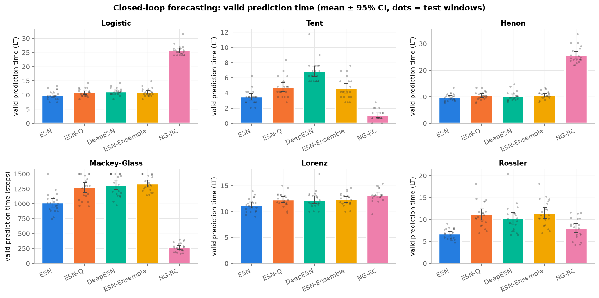

**Findings.**
1. **The quadratic readout is a consistent win.** ESN-Q beats the linear ESN on
   all six systems, most strongly on Rössler (+65%).
2. **NG-RC is exact when the dynamics are polynomial.** The logistic and Hénon
   maps are quadratic in the delay coordinates, so NG-RC recovers the true map
   (one-step NRMSE about 1e-12) and its horizon is limited only by float64
   round-off: an error of 1e-16 grows to O(1) in about ln(10¹⁶) ≈ 37 e-foldings.
   On non-polynomial systems (the tent map's kink, the Mackey-Glass delay) it
   falls far behind the ESNs.
3. **Depth helps on the non-smooth tent map** (6.9 vs 4.7 LT). The extra layer
   gives a richer nonlinear expansion around the kink.
4. **The consensus ensemble has the best or near-best mean on every
   continuous-time system**, and the smallest confidence interval on
   Mackey-Glass and Lorenz.

### A.2 RC-02: Reservoir topology

| topology | Lorenz VPT (LT) | NARMA-10 NRMSE | memory capacity (N=100) |
|---|---|---|---|
| dense | 10.11 ± 0.44 | 0.293 ± 0.003 | 22.9 ± 0.9 |
| Erdős–Rényi | 11.31 ± 0.31 | 0.294 ± 0.006 | 18.9 ± 1.5 |
| small-world | **11.52 ± 0.17** | 0.321 ± 0.013 | 20.0 ± 1.3 |
| ring (SCR) | 11.16 ± 0.35 | **0.255 ± 0.007** | **35.4 ± 2.1** |
| cycle + jumps | 11.24 ± 0.30 | 0.302 ± 0.003 | 23.3 ± 0.8 |
| delay line | 11.23 ± 0.33 | 0.256 ± 0.007 | 34.3 ± 1.9 |

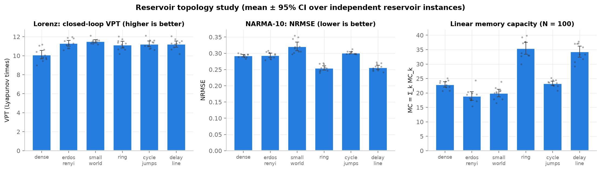

The *deterministic* ring reservoir has no random recurrent weights at all, yet
it matches random graphs on Lorenz. It is also the best on NARMA-10, a task
that needs 10 steps of memory, and has about 1.8× the memory capacity of a
sparse random reservoir. This confirms Rodan & Tiňo's "minimum complexity"
result in our setting. The dense reservoir is the worst forecaster.

### A.3 RC-03: Memory–nonlinearity trade-off

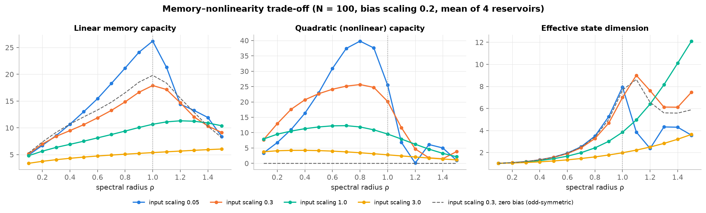

* **Linear memory capacity peaks at ρ ≈ 1** (26.2 for input scaling 0.05) and
  falls as the input scaling grows, because stronger inputs saturate `tanh`.
* **Quadratic capacity peaks *below* the edge of stability, at ρ ≈ 0.8**
  (39.8), and collapses for ρ > 1.1. Memory and nonlinearity are maximised at
  different operating points.
* **Symmetry control.** With zero bias the reservoir is odd-symmetric, and its
  quadratic capacity is **exactly 0.0** at every ρ, while its linear memory is
  *higher* (19.8 vs 17.9). The bias buys nonlinearity at the cost of memory.
  This is the mechanism behind the quadratic-readout gains in RC-01.

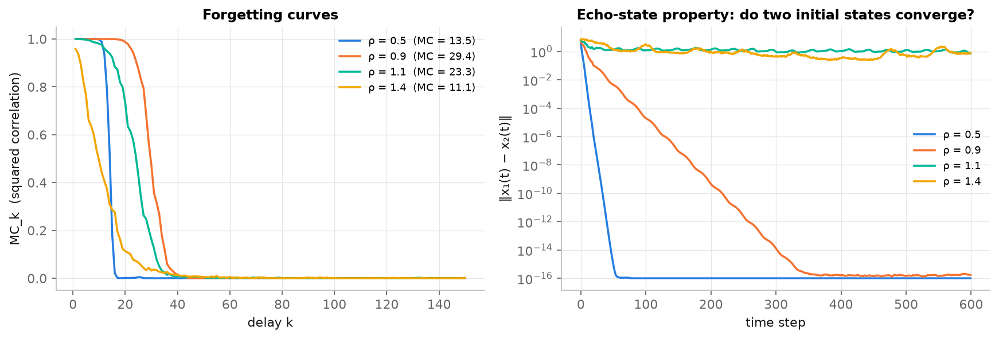

The echo-state-property test (right) shows that two reservoir copies converge
to machine precision for ρ = 0.5 and 0.9, but stay O(1) apart for ρ = 1.1 and
1.4: with this small input drive, fading memory is lost once ρ exceeds 1.

### A.4 RC-04: Hyperparameter landscape and size scaling

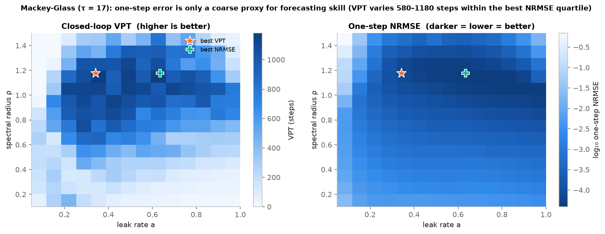

On a 14 × 14 grid (spectral radius × leak rate) on Mackey-Glass, one-step
NRMSE and VPT are strongly rank-correlated (Spearman 0.86), and their optima
are close (VPT 1180 vs 1164). However, **among the best quartile of
configurations by one-step error, VPT ranges from 580 to 1180 steps**. One-step
error cannot tell these configurations apart, which is why all our tuning
optimises VPT directly.

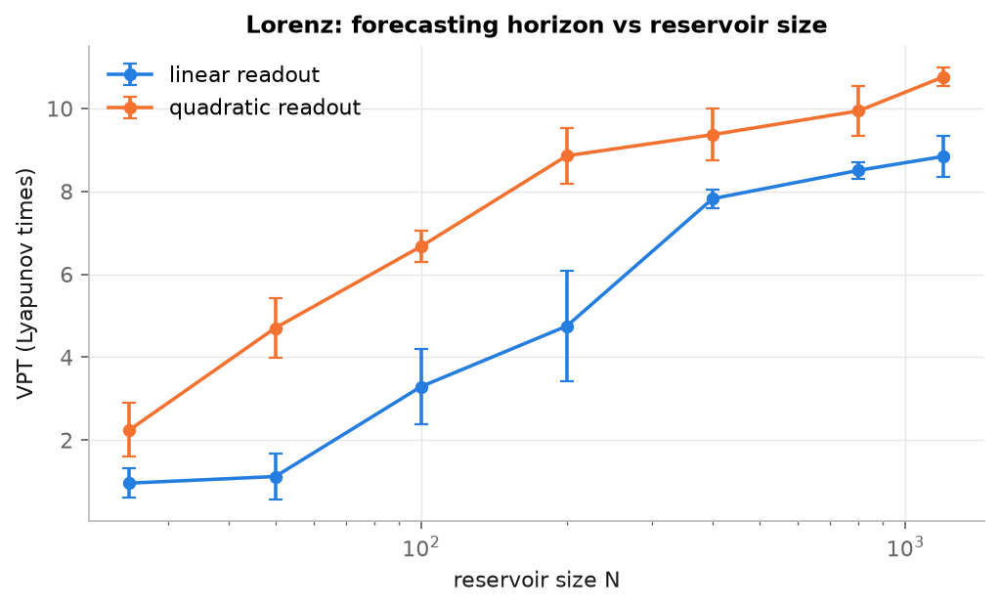

On Lorenz, a **quadratic readout with N = 200 (8.86 ± 0.67 LT) equals a linear
readout with N = 1200 (8.84 ± 0.49 LT)**: a six-fold reduction in reservoir size.

### A.5 RC-05: Long-term climate replication

Each model runs autonomously for 20 000 steps (~360 Lyapunov times), long
after any trajectory-level agreement has been lost.

| model | stays on attractor | W₁(density of z) | W₁(z-maxima) | log-spectrum distance | λ_max |
|---|---|---|---|---|---|
| ESN-Q | yes | 0.029 | 0.087 | 0.430 | **0.907** |
| ESN-Ensemble | yes | **0.026** | **0.081** | **0.424** | |
| NG-RC | yes | 0.083 | 0.137 | 0.427 | |
| truth | | 0 | 0 | 0 | 0.904 |

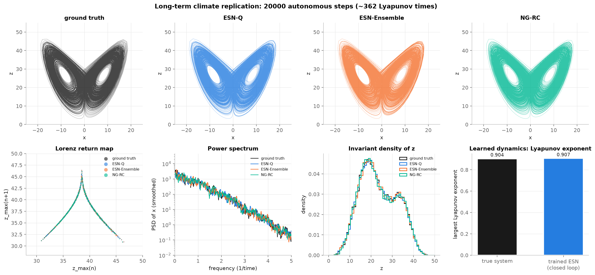

All three models remain on the attractor and reproduce the Lorenz return map.
The ensemble is the most faithful on every climate metric. **The largest
Lyapunov exponent of the trained ESN**, computed directly in its 400-dimensional
closed-loop state space, is 0.907 against a true value of 0.904. The network
has learned the system's rate of information production, not just its
trajectories.

### A.6 RC-06: Observation noise

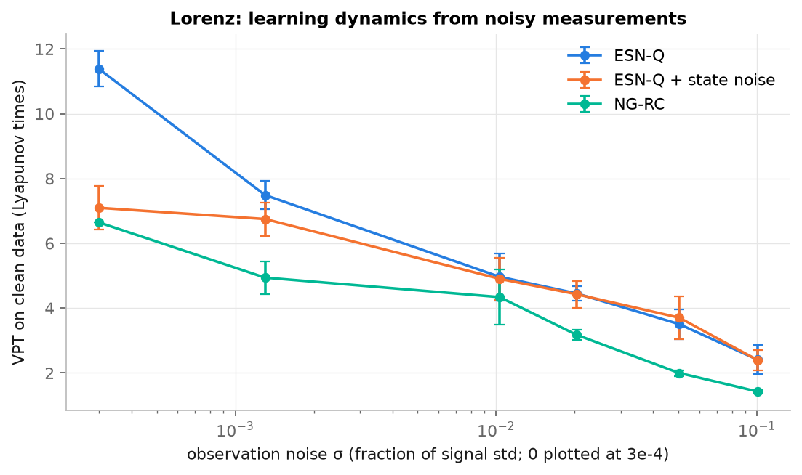

| noise σ | ESN-Q | ESN-Q + state noise | NG-RC |
|---|---|---|---|
| 0 | **11.38 ± 0.55** | 7.10 ± 0.67 | 6.65 ± 0.00 |
| 0.1% | **7.49 ± 0.44** | 6.75 ± 0.52 | 4.94 ± 0.51 |
| 1% | 4.97 ± 0.73 | 4.91 ± 0.65 | 4.34 ± 0.85 |
| 5% | 3.51 ± 0.46 | 3.70 ± 0.67 | 2.00 ± 0.09 |
| 10% | 2.41 ± 0.44 | 2.40 ± 0.31 | 1.43 ± 0.05 |

* Even 0.1% observation noise costs about a third of the forecasting horizon,
  which shows how sensitive chaotic forecasting is to data quality.
* **The ESN degrades more gracefully than NG-RC** at every noise level
  (1.75× NG-RC's horizon at 5% noise). NG-RC's polynomial features amplify
  noise in the delay taps.
* **Negative result:** state-noise injection during training, a commonly
  recommended regulariser, did not help. It hurt on clean data and was
  neutral on noisy data. Ridge regularisation alone was enough here.

*(This study uses a fixed NG-RC configuration, k = 2, s = 1; the tuned NG-RC
in RC-01 reaches 13.2 LT on clean data.)*

### A.7 RC-07: Data efficiency

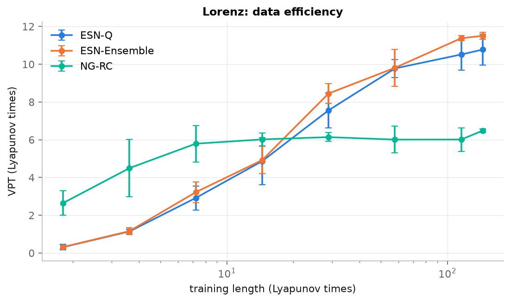

| training length (LT) | ESN-Q | ESN-Ensemble | NG-RC (k=2, s=1) |
|---|---|---|---|
| 1.8 | 0.31 | 0.32 | **2.65** |
| 7.2 | 2.92 | 3.22 | **5.79** |
| 28.9 | 7.56 | **8.45** | 6.14 |
| 144.5 | 10.77 | **11.50** | 6.48 |

NG-RC is very data-efficient: it has few parameters, and from about 2
Lyapunov times of data it already forecasts 2.6 LT ahead. With this fixed
feature set, though, it saturates. The ESNs need about 30 LT of data to
overtake it and keep improving. The ensemble is consistently the best ESN
variant, and its run-to-run variability is 5× smaller at the largest training
length (±0.18 vs ±0.81).

---

## Part B: Neurochaos learning

### B.0 Setup

Datasets: iris, wine, breast cancer and digits (8×8 images), plus four
nonlinear 2-D problems (moons, circles, XOR, spirals). The metric is macro-F1.

### B.1 NL-01: Benchmark under nested cross-validation

The outer loop is a 5-fold stratified CV repeated twice. Inside each training
fold, a 25-candidate randomised 3-fold search tunes every model's
hyperparameters: (q, b, ε) for neurochaos models, and C, γ, k, depth and so on
for the baselines. No test data is used for tuning.

| model | iris | wine | breast c. | digits | moons | circles | XOR | spirals | **mean** |
|---|---|---|---|---|---|---|---|---|---|
| ChaosNet (original) | .830 | .902 | .915 | .879 | .826 | .817 | .546 | .678 | .799 |
| **ChaosNet-Std** (ours) | .876 | .929 | .926 | .874 | .839 | .913 | .550 | .731 | .830 |
| ChaosFEX + SVM | .918 | .944 | .949 | .963 | .918 | .975 | .879 | .954 | .937 |
| ChaosFEX + LR | .956 | .945 | .948 | .950 | .900 | .967 | .607 | .792 | .883 |
| **MP-ChaosFEX + SVM** (ours) | .953 | .972 | .955 | .975 | .922 | .982 | .869 | .986 | **.952** |
| SVM-RBF | .949 | .977 | .969 | .982 | .943 | .990 | .864 | .995 | .959 |
| LogReg | .960 | .983 | .977 | .968 | .877 | .470 | .417 | .710 | .795 |
| kNN | .960 | .975 | .958 | .975 | .937 | .987 | .866 | .998 | .957 |
| RandomForest | .950 | .981 | .956 | .976 | .925 | .979 | .875 | .989 | .954 |
| MLP | .963 | .969 | .972 | .978 | .937 | .990 | .883 | .992 | .961 |

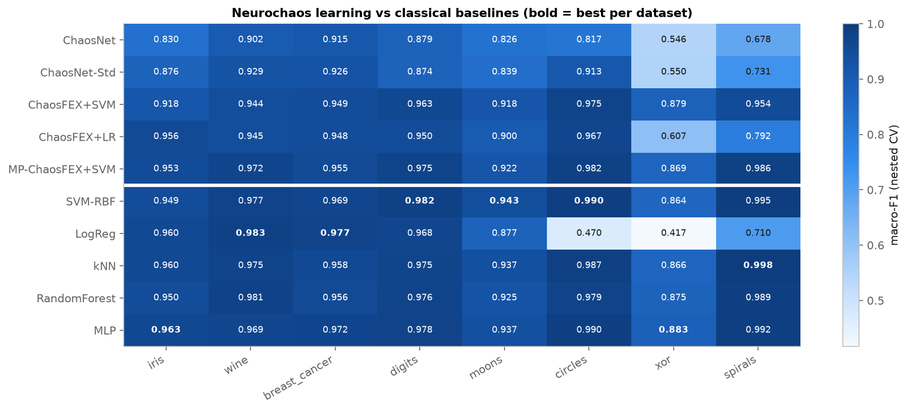

**Findings.**
1. **Our two NL improvements are the largest effects in the table.**
   Standardisation raises ChaosNet on 7 of 8 datasets (+3.1 points on
   average; +9.6 on circles). Multi-population encoding raises ChaosFEX + SVM
   from .937 to .952 on average (+3.2 on spirals, +3.5 on iris, +2.8 on wine).
2. **ChaosFEX is a strong nonlinear feature map.** A *linear* logistic
   regression on ChaosFEX features solves circles (.967 vs .470 on raw
   features) and spirals (.792 vs .710).
3. **Tuned classical models are still slightly ahead.** MP-ChaosFEX + SVM is
   within 0.2–0.9 F1 points of RandomForest, kNN, SVM and MLP on average. On
   XOR, single-population ChaosFEX + SVM (.879) is second only to the MLP (.883)
   and ahead of every other baseline.

### B.2 NL-02: Very few training samples

Hyperparameters are fixed for all models (tuning is impossible with one
sample per class). Each point averages 30 random draws.

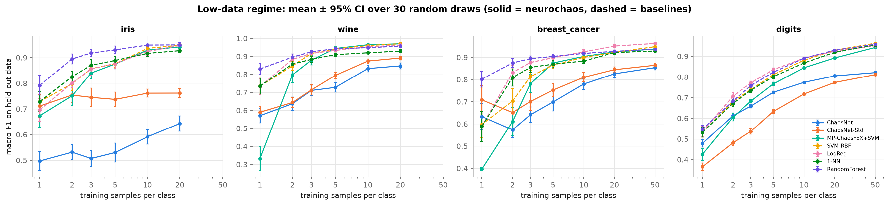

| samples/class | ChaosNet | ChaosNet-Std | MP-ChaosFEX+SVM | SVM | LogReg | 1-NN | RF |
|---|---|---|---|---|---|---|---|
| iris, 1 | .497 | .711 | .673 | .729 | .696 | .729 | **.792** |
| iris, 10 | .591 | .762 | .929 | .936 | .923 | .916 | **.949** |
| wine, 1 | .570 | .590 | .332 | .735 | .732 | .735 | **.830** |
| wine, 10 | .832 | .874 | **.965** | .960 | .953 | .920 | .948 |
| breast c., 1 | .633 | .708 | .396 | .597 | .589 | .589 | **.802** |
| breast c., 50 | .854 | .864 | .937 | .948 | **.962** | .929 | .936 |

**We could not reproduce a neurochaos advantage in the extreme low-data
regime.** Random forest is the strongest model with 1–3 samples per class.
ChaosNet-Std does beat SVM, logistic regression and 1-NN on breast cancer
with one sample per class (.708 vs ≤ .597). MP-ChaosFEX + SVM becomes
competitive from about 5 samples per class and is the best model on wine at
10 per class. We report this as a careful negative replication: published
low-data results for ChaosNet use per-dataset tuned (q, b, ε), which a
genuinely tiny training set cannot support (see NL-03).

### B.3 NL-03: Hyperparameter landscape and robustness

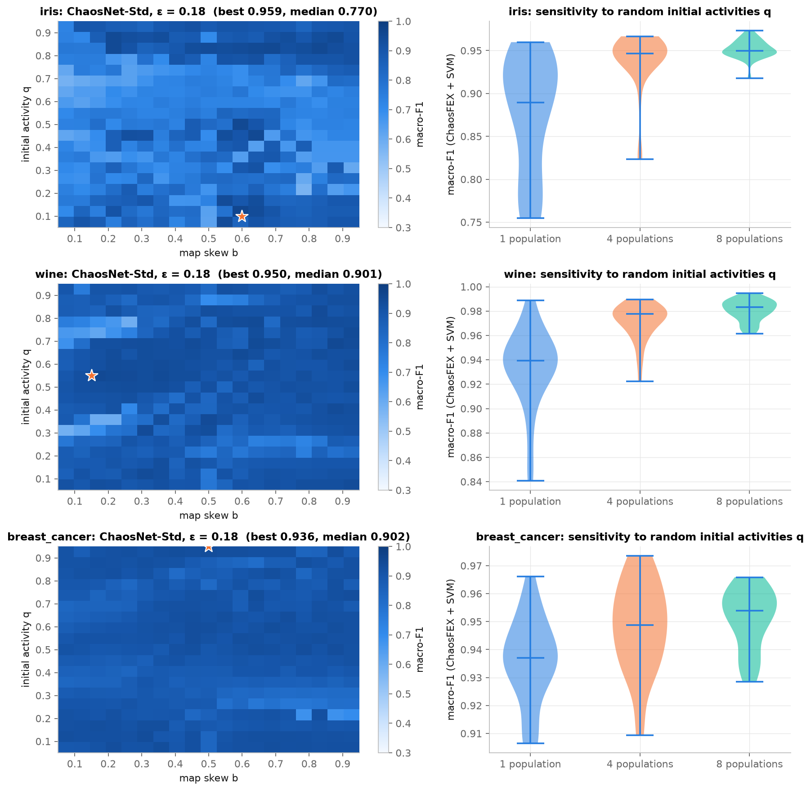

Over the (q, b) grid, ChaosNet-Std's F1 on iris ranges from 0.568 to 0.959
(median 0.770), and neighbouring grid cells can differ by up to 31 points. The
firing-time code `N(x)` is a highly discontinuous function of q and b.
**Multi-population encoding largely removes this sensitivity.** Over 30
random draws of q:

| dataset | 1 population | 4 populations | 8 populations |
|---|---|---|---|
| iris | 0.877 (worst .755) | 0.940 | **0.952** (worst .918) |
| wine | 0.933 | 0.971 | **0.981** |
| breast cancer | 0.936 | 0.948 | **0.951** |

### B.4 NL-04: Stochastic-resonance-like effect of ε

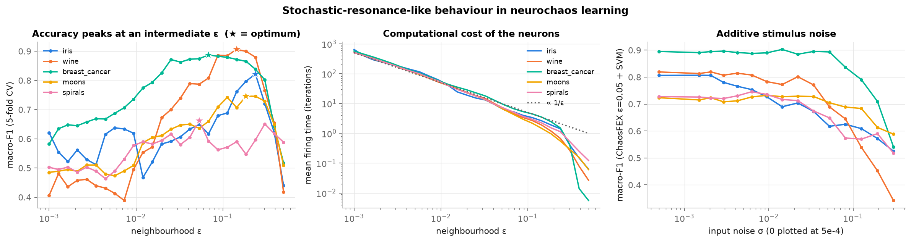

| dataset | F1 at ε = 0.001 | best F1 (ε*) | F1 at ε = 0.5 |
|---|---|---|---|
| iris | .621 | **.822** (0.24) | .440 |
| wine | .406 | **.906** (0.14) | .418 |
| breast cancer | .583 | **.887** (0.07) | .517 |
| moons | .485 | **.746** (0.19) | .509 |
| spirals | .503 | **.663** (0.05) | .588 |

Every dataset shows a pronounced interior optimum in ε, which replicates the
stochastic-resonance interpretation of Harikrishnan & Nagaraj. The middle
panel shows the cost side: the mean firing time scales as **≈ 0.5/ε**, which
is exactly the expected waiting time for a uniformly distributed orbit to
enter an interval of width 2ε. Adding *explicit* Gaussian noise to the
stimulus gives at most +0.02 F1, within CV noise. The useful "noise" is the
ε-neighbourhood itself.

### B.5 NL-05: Feature ablation (all 31 subsets)

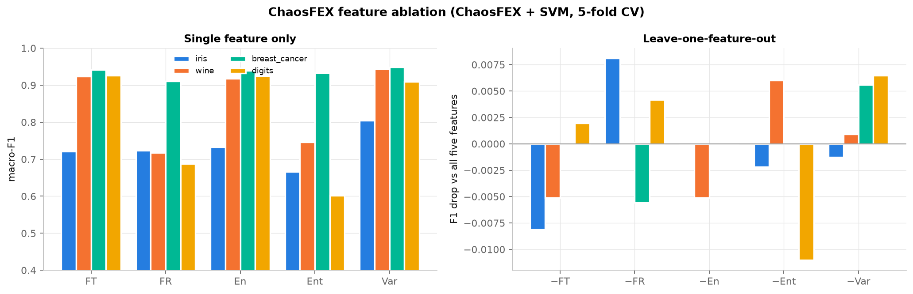

| features | iris | wine | breast c. | digits | mean |
|---|---|---|---|---|---|
| **variance only** | .804 | .944 | .949 | .909 | **.901** |
| energy + variance | .790 | .939 | .947 | .925 | .900 |
| all five | .765 | .946 | .943 | .926 | .895 |
| standard ChaosFEX (FT+FR+En+Ent) | .767 | .945 | .937 | .919 | .892 |
| firing rate only | .723 | .717 | .910 | .688 | .760 |
| entropy only | .666 | .746 | .933 | .601 | .737 |

Every feature is a deterministic function of the firing time N(x), so the
features differ only in how they re-express N. The variance of the neural
trace, a feature that is not part of standard ChaosFEX, is the single most
useful re-expression. Firing rate and entropy alone are weak: for long traces
the firing rate tends to about 1 − b ≈ 0.5 and the entropy to about 1 bit, so
they carry little information about N.

### B.6 NL-06: Chaotic map × number of populations

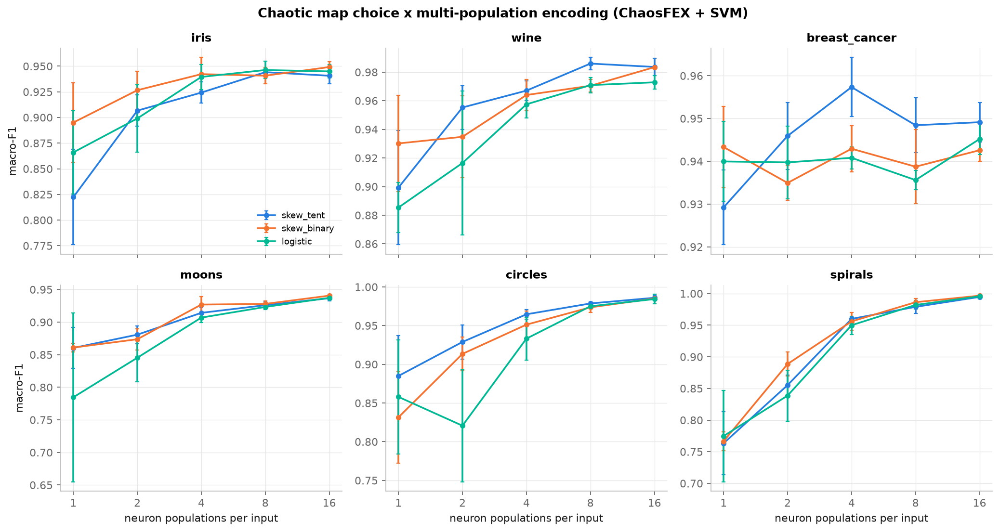

F1 rises sharply up to 4–8 populations and then plateaus (skew-tent map):

| dataset | 1 | 2 | 4 | 8 | 16 |
|---|---|---|---|---|---|
| spirals | .763 | .855 | .960 | .979 | **.995** |
| circles | .885 | .929 | .965 | .979 | **.986** |
| wine | .899 | .955 | .967 | **.986** | .984 |
| iris | .822 | .907 | .924 | **.944** | .941 |

With one population the choice of map matters (up to about 8 points). From 4
populations on, all three maps converge: **the encoding diversity matters
more than the specific chaotic map.**

### B.7 NL-07: Shared-trajectory ChaosFEX, speed and exactness

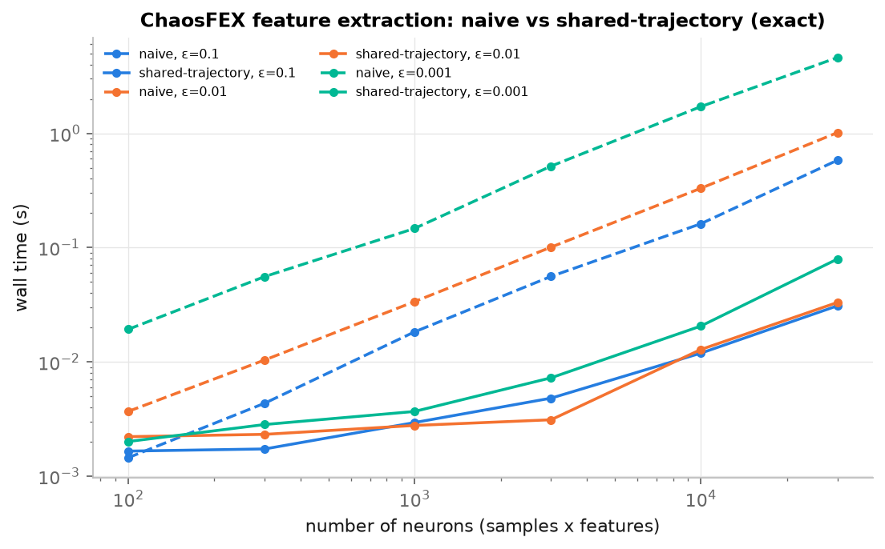

| ε | neurons | naive | shared-trajectory | speed-up | max abs diff |
|---|---|---|---|---|---|
| 0.1 | 30 000 | 0.58 s | 0.031 s | 19× | 4e-16 |
| 0.01 | 30 000 | 1.01 s | 0.033 s | 31× | 9e-14 |
| 0.001 | 10 000 | 1.71 s | 0.021 s | **83×** | 3e-12 |

Both implementations use the same pure-Python scalar map, so the speed-up
comes from the algorithm alone. The gain grows as ε shrinks, because the
naive cost scales with the total firing time Σ N while the fast cost is one
trajectory plus vectorised work. The differences are pure floating-point
summation order (relative ~1e-16). The unit tests assert agreement for all
maps. Timings for more than 3000 neurons extrapolate the naive method linearly.

### B.8 NL-08: Inside the GLS neuron

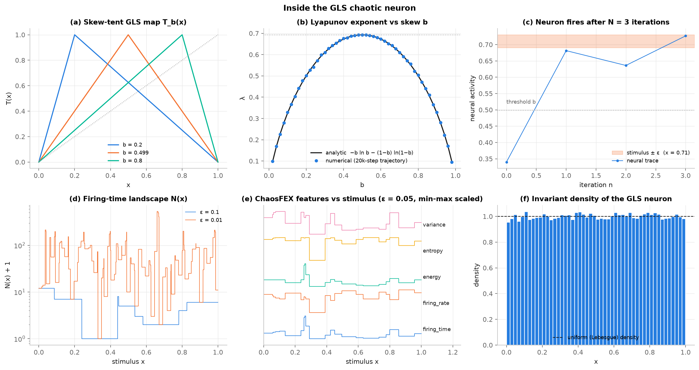

The numerical Lyapunov exponent of the skew-tent neuron matches the analytic
`−b ln b − (1−b) ln(1−b)` to within about 0.01 for all b. The invariant density is
uniform (panel f), which is the property that guarantees every stimulus
eventually fires the neuron. Panel (d) shows the firing-time landscape `N(x)`:
a jagged function of the stimulus whose resolution is set by ε. This is the
object that ChaosFEX actually feeds to the classifier.

---

## Discussion

**Reservoir computing.** Three design choices matter more than the rest:
(i) breaking the `tanh` odd symmetry (quadratic readout or bias), (ii) tuning
on closed-loop skill rather than one-step error, and (iii) ensembling with
consensus feedback. Together they give horizons of 11–13 Lyapunov times on
Lorenz and Rössler with only 400 units, and a surrogate whose Lyapunov
exponent matches the true system. NG-RC is unbeatable when the true dynamics
are low-degree polynomials and when data is scarce, but it is fragile under
noise and non-polynomial dynamics. Simple deterministic topologies (rings)
are a strong default.

**Neurochaos learning.** Every ChaosFEX feature is a function of one integer,
the firing time `N(x)`, so a single neuron population is a scalar "chaotic
hash" of each input coordinate. This explains both its hyperparameter
fragility and why *multiple populations*, several independent hashes, help so
much: they make the code injective, and they lift ChaosFEX + SVM to within
about one F1 point of tuned SVMs, kNN and random forests. The stochastic-resonance
behaviour in ε is real and reproducible. The claimed small-sample advantage
did not appear under a protocol with fixed hyperparameters; we think this is
the most important open question for the method.

**Limitations.** Low-dimensional benchmark systems and datasets only; NG-RC
in RC-06/07 uses a fixed feature set; capacities are measured in noise-free
simulation, where they are invariant to signal scale; runtime comparisons
are single-machine.

## Reproducibility

* Every experiment is seeded. `./run_all.sh` regenerates every figure and
  table (about 50 minutes on 16 CPU cores); `RCEXPL_QUICK=1` runs a reduced
  smoke test.
* Library correctness is covered by 30 unit tests, including bit-level
  agreement of fast and naive ChaosFEX, spectral-radius scaling of every
  topology, the echo-state property, exact recovery of the logistic map by
  NG-RC, and Lyapunov estimates against literature values.
* The full mathematical definitions are in [METHODS.md](METHODS.md).
